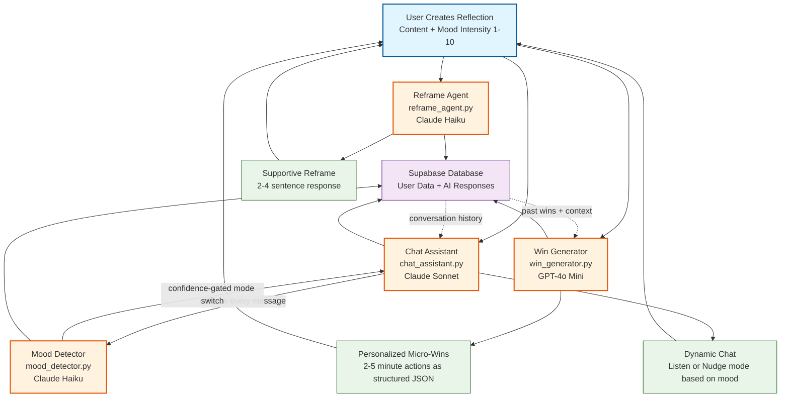

# Build Resilience

An AI reflection prototype that turns a setback into a reframe and a small next action. A FastAPI backend coordinates four specialized agents for mood analysis, reframing, action suggestions and chat. The original client was built in React Native/Expo.

## Repository status

The implementation history is from June 2025. The root architecture overview and the rename to Build Resilience were added in May 2026; they do not represent a new 2026 build or a live service.

The repository currently contains two different implementation tracks:

| Path | What it contains | Status |
|---|---|---|
| `resilience-backend/` | The multi-agent FastAPI backend described below, with Supabase and model-provider integrations. | The current architecture reference in this repository. |
| `ResilienceApp/` | A Gitlink to the intended React Native client. | The Gitlink is present, but this repository has no `.gitmodules` mapping, so a fresh clone cannot retrieve this client. |
| `backend/` + `frontend/` | An earlier, lightweight FastAPI/Expo demo using in-memory data. | Separate from the multi-agent backend; its routes and setup should not be assumed compatible with `resilience-backend/`. |

No hosted demo or current production deployment is represented here.

---

## Multi-Agent AI Architecture

The core of this project is a purpose-built multi-agent system where specialized agents handle distinct cognitive tasks, and the chat layer dynamically orchestrates them.



### The Agents

All agents extend a shared `BaseAgent` abstract class (`services/ai/base_agent.py`) that enforces a common interface while allowing each agent to use the right model for its job.

| Agent | Model | Responsibility |
|---|---|---|
| `MoodDetectionAgent` | Claude Haiku | Analyzes conversation history in real-time. Returns structured JSON with `should_listen` (bool), `confidence_score` (0–1), `emotional_intensity` (1–10), and `processing_stage` (initial → processing → plateau → ready) |
| `ReframeAgent` | Claude Haiku | Validates feelings, defuses shame, generates a compassionate 2–4 sentence reframe for the user's specific situation |
| `WinGeneratorAgent` | GPT-4o Mini | Suggests 1–2 personalized micro-wins (2–5 min actions) calibrated to current mood intensity, returned as structured JSON |
| `ChatAssistantAgent` | Claude Sonnet | Calls `MoodDetectionAgent` on every message, then switches between **Listen Mode** (validation, open questions) and **Nudge Mode** (gentle action guidance) based on a confidence threshold of 0.7 |

### Agent Composition Pattern

`ChatAssistantAgent` composes `MoodDetectionAgent` as a sub-agent — the mood analysis result gates which system prompt is used for the response:

```python
mood_analysis = await self.mood_detector.analyze_conversation(history, message)

if mood_analysis.should_listen and mood_analysis.confidence_score > 0.7:
    response_mode = "listen"
elif not mood_analysis.should_listen and mood_analysis.confidence_score > 0.7:
    response_mode = "nudge"
else:
    response_mode = current_mode  # hold steady if uncertain
```

### Intentional Cross-Provider Design

**Anthropic (Claude)** is used for tasks requiring empathy, nuanced emotional reasoning, and natural conversation — reframing, mood detection, chat.

**OpenAI (GPT-4o Mini)** is used for `WinGeneratorAgent` because it reliably returns structured JSON output for the win suggestion schema. Different models, chosen for their strengths.

---

## Agentic E2E Testing

`test_agentic_e2e.py` uses an AI-driven testing approach: a `AgenticTestAgent` backed by GPT-4 uses Playwright to analyze page state and decide what to interact with, rather than following a hardcoded script. It extracts buttons, inputs, and page structure, gets an AI assessment of whether the goal was achieved, and adapts its actions accordingly.

---

## Stack

**Frontend** — `ResilienceApp/`
- React Native 0.79 with Expo SDK 53
- React 19, TypeScript
- Supabase JS for auth + data
- TanStack Query for server state
- Zustand for local state
- React Navigation, Zod, React Hook Form

**Backend** — `resilience-backend/`
- Python FastAPI, Uvicorn
- Supabase (PostgreSQL + Auth)
- Anthropic SDK `0.54.0`, OpenAI SDK `1.86.0`
- Pydantic v2, PyJWT, python-jose

---

## Project Structure

```
.
├── ResilienceApp/                  # React Native frontend
│   └── src/
│       ├── screens/                # Home, Reflection, Reframe, WinSelection
│       ├── services/               # Supabase + API integration
│       ├── store/                  # Zustand app + auth state
│       └── types/                  # TypeScript definitions
│
├── resilience-backend/             # FastAPI backend
│   └── app/
│       ├── api/v1/                 # auth, chat, reflections, reframes, wins, streaks
│       ├── services/ai/            # Agent implementations
│       │   ├── base_agent.py       # Abstract base class
│       │   ├── chat_assistant.py   # Orchestrator — composes MoodDetector
│       │   ├── mood_detector.py    # Conversation analysis sub-agent
│       │   ├── reframe_agent.py    # Compassionate reframing
│       │   └── win_generator.py    # Micro-win generation
│       ├── models/                 # Pydantic request/response models
│       └── core/                   # Config, database, security
│
├── test_agentic_e2e.py             # AI-driven E2E test suite (Playwright + GPT-4)
└── AI_AGENTS_ARCHITECTURE.md       # Detailed architecture diagrams
```

---

## Local setup: backend reference

This path starts only the `resilience-backend/` API. The intended React Native client is not retrievable from a fresh clone because of the missing submodule mapping above.

### Backend

```bash
cd resilience-backend
python3 -m venv .venv
source .venv/bin/activate
pip install -r requirements.txt

# Copy and fill in the service configuration
cp .env.example .env

# Run dev server
python -m uvicorn app.main:app --reload
```

Required env vars:
```
SUPABASE_URL=
SUPABASE_SERVICE_KEY=
ANTHROPIC_API_KEY=
OPENAI_API_KEY=
```

`GET /health` can start without service credentials. Authenticated flows, stored data, and model-backed responses require a configured Supabase project (including the schema in `create_database_tables.sql`) plus valid provider keys. Model-provider calls may incur cost.

### Tests and demos

The repository includes historical shell runners and an agentic E2E script. They are not a verified, credential-free test path: they install dependencies, expect the unavailable `ResilienceApp/` client, and the agentic script may call a model provider. Inspect and adapt them before running; no current passing E2E result is claimed by this README.

---

## API Overview

| Resource | Endpoints |
|---|---|
| Health | `GET /` `GET /health` |
| Reflections | `POST/GET/PUT/DELETE /api/v1/reflections/` |
| Reframes | `POST /api/v1/reframes/generate` |
| Wins | `GET /api/v1/wins/suggest` `POST /api/v1/wins/complete` |
| Streaks | `GET /api/v1/streaks/current` |
| Chat | `POST /api/v1/chat/start` `POST /api/v1/chat/message` |
